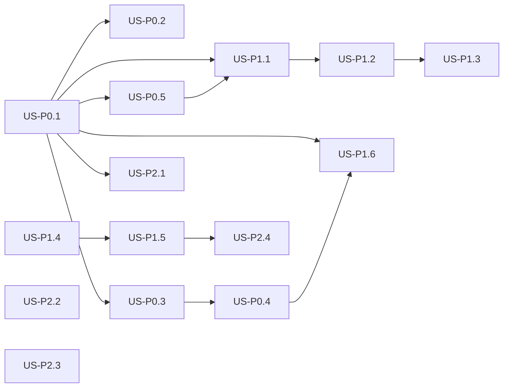

# Quest Paperclip User Stories

Agent-ready stories for `C:\Projects\paperclip-app`, written from the lead-programmer review. One story = one focused change. This folder is the backlog.

> [!important] Conventions for agents
> - **One story = one PR.** Do not start the next epic until its blockers are done.
> - **Local only.** Keep FastAPI on `127.0.0.1:8001`. Do not bind `0.0.0.0` or add auth-less LAN exposure.
> - **Do not invent token or cost numbers.** Parse usage from the runner, or store `unknown`.
> - **Do not treat HTTP 200 as success.** Success is `ok: true` plus useful stdout / a succeeded job.
> - **Do not commit or push** unless the user asks.
> - New tickets: copy [[Story Template]].
> - This is **not** Paperclip Cloud / `paperclipai`.

Repo: `C:\Projects\paperclip-app`
Operator guide: `docs/SYSTEM.md`
Related story vaults (do not rewrite them here):
- TaxProgram: `C:\Obsidian\TaxProgram\userStories\`
- Math Quest: `C:\Obsidian\quest vault\Math Quest\userStories\`

## Board

Set a story's `status` to `todo`, `assigned`, `in-progress`, `review`, or `done`.

Lanes match the Next board:

| Lane | Stored status |
|---|---|
| Backlog | `todo` |
| Assigned | `assigned` |
| In Progress | `in-progress` |
| Review Required | `review` |
| Completed | `done` |

## Epics

### Epic 0 — Stop treating a run as a request (P0, do first)
- [[US-P0.1 Jobs table and async run]]
- [[US-P0.2 Cancel and force-idle]]
- [[US-P0.3 Shared runner contract]]
- [[US-P0.4 Real token and cost parse]]
- [[US-P0.5 One status vocabulary]]

### Epic 1 — Make the product match the docs (P1)
- [[US-P1.1 Story-aware agent run]]
- [[US-P1.2 Import Obsidian user stories]]
- [[US-P1.3 Export story status back to Obsidian]]
- [[US-P1.4 Next.js is the only operator UI]]
- [[US-P1.5 Hygiene, Python pin, and CORS lock]]
- [[US-P1.6 Smoke tests for health, run, and budget]]

### Epic 2 — Operator quality (P2)
> [!warning] Do not start before Epic 0 is done. Auth (US-P2.4) is required before binding past localhost.

- [[US-P2.1 Live job traces]]
- [[US-P2.2 Supervise uvicorn in start-paperclip.ps1]]
- [[US-P2.3 Agent delete and archive]]
- [[US-P2.4 Auth and working-dir allowlist]]

## Suggested sprint order

| Sprint | Stories | Why |
|---|---|---|
| 1 | [[US-P0.1 Jobs table and async run\|US-P0.1]], [[US-P0.2 Cancel and force-idle\|US-P0.2]] | Unstick Running cards |
| 1 | [[US-P0.3 Shared runner contract\|US-P0.3]], [[US-P0.5 One status vocabulary\|US-P0.5]] | One code path, one board language |
| 2 | [[US-P0.4 Real token and cost parse\|US-P0.4]], [[US-P1.6 Smoke tests for health, run, and budget\|US-P1.6]] | Spend you can trust + a test harness |
| 2 | [[US-P1.1 Story-aware agent run\|US-P1.1]] | Stories actually launch work |
| 3 | [[US-P1.2 Import Obsidian user stories\|US-P1.2]], [[US-P1.3 Export story status back to Obsidian\|US-P1.3]] | Quest Studio loop |
| 3 | [[US-P1.4 Next.js is the only operator UI\|US-P1.4]], [[US-P1.5 Hygiene, Python pin, and CORS lock\|US-P1.5]] | One UI + a clean branch |
| 4 | [[US-P2.1 Live job traces\|US-P2.1]], [[US-P2.2 Supervise uvicorn in start-paperclip.ps1\|US-P2.2]], [[US-P2.3 Agent delete and archive\|US-P2.3]] | Operator quality |
| later | [[US-P2.4 Auth and working-dir allowlist\|US-P2.4]] | Before any non-localhost bind |

## Blockers

